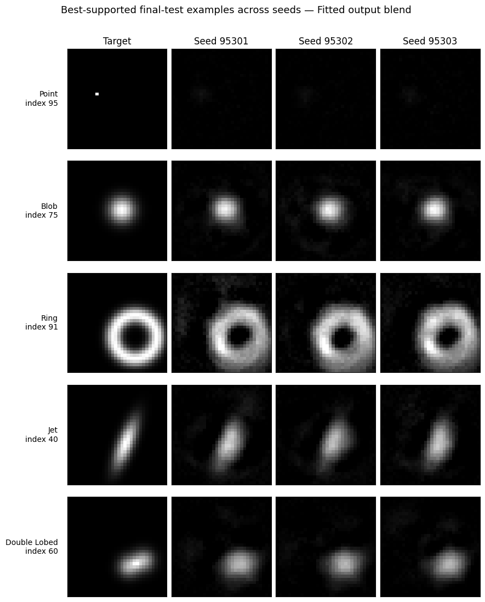

# Graph Interferometric Reconstruction

This repository contains a compact reference implementation of the simulation
and graph-reconstruction components developed for James Streitberg's Honours
thesis on graph representations for learned radio-interferometric imaging.

The repository deliberately omits the full experiment archive. It retains:

- the five synthetic source families: point, blob, ring, jet and double-lobed;
- controlled array generation, including the structural SKA-Low analogue;
- the discrete visibility operator and graph input features;
- the antenna-centred message-passing model;
- the retained baseline-centred line-graph model with raw-feature reinjection;
- the three retained hybrid pathways: fitted output blending, scratch A-B
  embedding concatenation, and pretrained then fine-tuned A-B concatenation;
- reconstruction-gallery plotting utilities.

## Repository structure

```text
src/graph_interferometry/
  sources.py       synthetic sky specifications and rasterisation
  arrays.py        controlled antenna layouts
  graphs.py        antenna and line-graph relations
  measurement.py   visibility operator and model input features
  models.py        standalone and hybrid graph models
  training.py      image and visibility-domain loss terms
  plotting.py      reconstruction galleries
examples/
  quickstart.py
  plot_reconstructions.py
tests/
  test_core.py
docs/figures/
  fitted_output_blend_gallery.png
```

## Installation

```bash
python -m venv .venv
python -m pip install -e ".[dev]"
pytest
```

PyTorch uses a CUDA device automatically when the caller moves the models and
tensors to CUDA. The package itself does not impose a device.

## Minimal use

```python
from graph_interferometry import (
    AntennaGraphMPNN,
    BaselineLineGraphMPNN,
    build_scratch_hybrid,
    generate_array,
    make_graph,
)

layout = generate_array("jittered_circle", number_of_antennas=16, seed=84221)
graph = make_graph(16)

antenna_model = AntennaGraphMPNN(graph, image_size=32)
baseline_model = BaselineLineGraphMPNN(graph, image_size=32)
scratch_hybrid = build_scratch_hybrid(graph, image_size=32)
```

Run `python examples/quickstart.py` after installation for an end-to-end shape
check from source generation to all retained architectures. Its networks are
untrained; the script is an interface check rather than a reconstruction
benchmark.

## Retained hybrid pathways

1. **Fitted output blend.** `FittedOutputBlend.fit` selects one scalar baseline
   weight on checkpoint predictions and holds it fixed for final evaluation.
2. **Scratch A-B concatenation.** `build_scratch_hybrid` independently
   initialises the antenna and baseline encoders, concatenates their
   128-dimensional readouts and trains the complete model jointly.
3. **Pretrained and fine-tuned A-B concatenation.**
   `build_finetuned_hybrid` copies the selected standalone encoders into the
   same concatenation architecture. All parameters remain trainable for the
   subsequent joint optimisation.

The fitted blend and fine-tuned pathway must use checkpoint data that remain
separate from final-test evaluation.

## Example reconstruction gallery



The displayed examples are favourable held-out cases selected after evaluation
to illustrate attainable behaviour. They do not replace aggregate reporting
over the complete final-test set.

## Scope and provenance

The code reproduces the retained data path and model definitions rather than
every exploratory ablation, corruption sweep or result table from the thesis.
The SKA-Low layout is a controlled structural analogue; it does not use official
SKA-Low station coordinates.

This repository reorganises implementations developed and run in the thesis
notebooks. Automated coding assistance was used to consolidate the notebook
code into modules and tests. The author is responsible for the research design,
execution, verification and interpretation.

No software licence has been assigned in this initial release.
